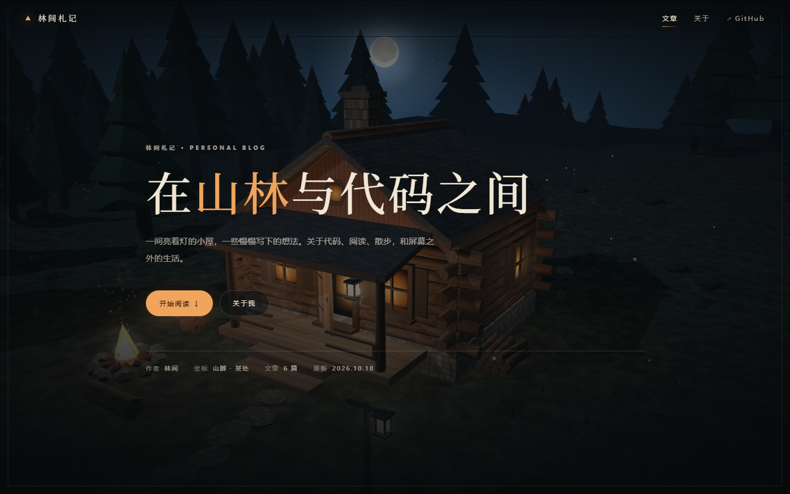

# 林间札记 · 个人博客

以「林中小屋」3D 场景为背景的极简个人博客。纯静态：没有框架、没有构建、没有数据库，改完直接拖到 Netlify 就能上线。



## 本地预览

**推荐用本地服务器**（3D 背景需要 iframe 加载，`file://` 下部分浏览器会拦截）：

```powershell
# 双击 start-share.cmd，或：
node serve.js
```

然后打开 <http://localhost:8080/>。

直接双击 `index.html` 也能看，但 3D 背景可能不会加载（会停在静态背景图上，不影响阅读）。

## 发布到 Netlify（三种方式，任选）

### 方式 A：拖拽部署（最快，30 秒）

1. 打开 <https://app.netlify.com/drop>
2. 把**整个 `cabin-blog` 文件夹**拖进页面
3. 等它转完，会得到一个 `https://随机名.netlify.app` 的网址，可以直接发给别人
4. 想改网址名：Site configuration → Change site name

> 注意拖**文件夹**，不要只拖 `index.html`——博客需要 `styles.css`、`posts.js`、`scene.html` 等一起上传。

### 方式 B：连接 Git 仓库（推荐长期维护）

1. 把整个文件夹推到 GitHub / GitLab
2. Netlify → Add new site → Import an existing project → 选仓库
3. 构建命令留空，**Publish directory 填 `.`**
4. 之后每次 push，Netlify 会自动重新发布

仓库里的 `netlify.toml` 已经写好了 publish 目录、缓存头和兜底跳转，不用再配。

### 方式 C：Netlify CLI

```powershell
npm i -g netlify-cli
netlify login
cd web\cabin-blog
netlify deploy --prod --dir .
```

## 换成你自己的内容

### 最快的方式：用浏览器里的写作台（推荐）

打开 **<https://yanblogg.netlify.app/admin>**，粘贴一个 GitHub 令牌，就能在网页里直接改文章、改站点信息，点「保存并发布」，一分钟内网站上就更新了。**不需要装任何东西，也不需要在电脑上留任何文件。**

第一次用要生成一次令牌（只要 30 秒，以后就不用再弄了）：

1. 打开 <https://github.com/settings/tokens/new?scopes=public_repo&description=cabin-blog>
2. **Note** 随便写（比如 `cabin-blog`），**Expiration** 建议选 90 天或 No expiration
3. 勾选 **`public_repo`**（在 `repo` 那一组下面）
4. 拉到最底点 **Generate token**，复制那一串 `ghp_` 开头的字符（**只显示这一次**，关掉就看不到了）
5. 回到 `/admin` 页面粘贴进去，勾上「记住本机」，点进入

> 令牌就等于你账号的钥匙，只粘在自己电脑上，别发给别人、别贴到聊天群里。它只存在你浏览器的 localStorage 里，不会上传到任何服务器；写作台直接把改动提交到你的 GitHub 仓库。
>
> 换了电脑或清了浏览器数据，重新粘一次就行。

写作台能做的事：

| 标签页 | 能干什么 |
| --- | --- |
| **文章** | 新建 / 编辑 / 删除文章，左边写右边实时预览，改动自动存本地草稿（关掉页面也不丢） |
| **照片** | 上传照片到「相册」页：一次可选多张，自动压缩（最长边 1920px 的 JPEG）后存进仓库 `photos/` 目录，也可以删除 |
| **站点信息** | 改站点名、首页大标题、作者、GitHub、邮箱、页脚这些 —— 对应 `site.js` |
| **源文件** | 直接编辑 `posts.js` / `site.js` 原文，写坏了会拦住不让你发布 |

快捷键 `Ctrl+S`（Mac 上 `Cmd+S`）＝ 保存并发布当前标签页。

相册页：网站顶栏的「相册」（<https://yanblogg.netlify.app/#/photos>）展示所有上传的照片，点击可以放大、左右切换。照片清单存在 `photos.js` 里，图片本体在 `photos/` 目录。

改完的样子：

- 网站地址：<https://yanblogg.netlify.app/>
- 写作台：<https://yanblogg.netlify.app/admin>
- 仓库：<https://github.com/yanlijin/cabin-blog>

### 或者：直接改文件（想自己折腾时）

#### 1. 改名 / 作者 / 联系方式

编辑 `site.js`，所有文案集中在这一个文件：

```js
window.SITE = {
  name: "林间札记",        // 站点名（顶栏、页脚、标题）
  title: "在山林与代码之间", // 首页大标题
  accent: "山林",          // 大标题里高亮的词，会变成橙色
  tagline: "...",          // 副标题
  author: "林间",
  avatar: "林",
  github: "https://github.com/你的用户名",
  email: "你的邮箱",
  ...
};
```

#### 2. 写文章

编辑 `posts.js`，复制一个块改内容即可：

```js
{
  slug: "my-post",        // 网址标识，英文短横线，不要重复
  title: "文章标题",
  date: "2026-11-01",     // 列表按日期从新到旧排
  tag: "随笔",            // 分类，筛选按钮会自动出现
  excerpt: "列表页显示的两行摘要",
  content: `正文……`
}
```

正文支持这些写法：

| 写法 | 效果 |
| --- | --- |
| 空行 | 分段 |
| `## 标题` | 二级标题 |
| `### 标题` | 三级标题 |
| `> 引用` | 引用块 |
| `- 条目` | 列表 |
| `**粗体**` / `*斜体*` | 强调 |
| `` `代码` `` | 行内代码 |
| `[文字](https://…)` | 链接 |
| `---` | 分隔线 |

#### 3. 换背景

- `bg.jpg` —— 桌面静态背景（1600×900，加载时的占位图）
- `bg-mobile.jpg` —— 手机静态背景（760×1200）
- `og.jpg` —— 分享到微信 / Twitter 时的预览图（1200×630）
- `scene.html` —— 真正会动的 3D 场景，来自 `../cabin-in-the-woods/cabin-in-the-woods.html`

想换建好的小屋，重新生成一次 `scene.html` 即可：

```powershell
copy ..\cabin-in-the-woods\cabin-in-the-woods.html scene.html
```

## 性能说明

- 静态背景图会**立刻**显示，3D 场景在浏览器空闲时再加载，就绪后淡入覆盖，不会白屏。
- 手机窄屏、开启省流模式、或系统设置了「减少动态效果」时，**不加载 3D**，只用竖版静态背景——省流量也更省电。
- 3D 场景是 `still` 模式（固定机位、不自动旋转、关闭界面），作为背景更安静，也更省 GPU。

## 文件

| 文件 | 说明 |
| --- | --- |
| `index.html` | 页面骨架 |
| `styles.css` | 全部样式 |
| `site.js` | 站点信息 / 关于页文案 |
| `posts.js` | 文章数据 |
| `photos.js` | 相册照片清单（`file`/`title`/`date`） |
| `photos/` | 上传的照片（通过写作台生成） |
| `app.js` | 路由、列表渲染、极简 Markdown、相册与灯箱 |
| `admin.html` / `admin.css` / `admin.js` | 浏览器里的写作台（`/admin`） |
| `scene.html` | 3D 林中小屋背景 |
| `bg.jpg` / `bg-mobile.jpg` / `og.jpg` | 静态背景与分享图 |
| `netlify.toml` | Netlify 部署配置 |
| `serve.js` / `start-share.cmd` | 本地预览服务器 |

## 常见问题

**3D 背景不动 / 不显示？**
开着省流、或系统开了「减少动态效果」时会主动跳过 3D。也可能是浏览器禁用了 WebGL，此时会停在静态背景图上，阅读不受影响。

**改了文章但页面没变？**
刷新时按 `Ctrl+F5` 强制刷新。部署到 Netlify 后如果还是旧的，等一两分钟 CDN 缓存过期。

**想加 RSS / 评论 / 统计？**
这个站是纯静态的，RSS 可以自己加一个 `feed.xml`；评论可以用 Giscus（基于 GitHub Discussions）；统计可以用 Netlify Analytics 或 Umami。

**写作台打不开 / 一直提示令牌无效？**
令牌可能过期了（GitHub 默认有有效期），重新生成一个粘进去。如果提示「找不到仓库或没有权限」，检查生成令牌时有没有勾 `public_repo`。

**写作台里改了但网站上没变？**
写作台的改动是提交到 GitHub，Netlify 收到 push 后自动重新部署，一般 30 秒到 1 分钟。可以在 <https://app.netlify.com/sites/yanblogg/deploys> 看部署进度，显示 Published 就生效了。
